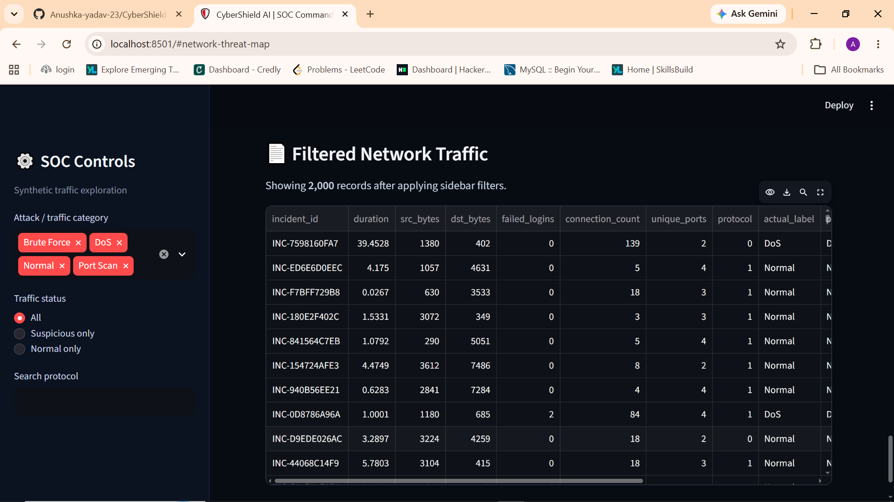

## 📸 Dashboard Preview

# CyberShield AI

## SOC Command Center - AI-Powered Network Threat Detection

CyberShield AI is a Streamlit-based cybersecurity demo dashboard that uses machine learning to analyse synthetic network traffic and support simulated incident investigation.

> **Demo only:** This project uses synthetic traffic only. It is not connected to a live network and does not block real devices.

## Features
- Interactive SOC dashboard
- Synthetic network traffic classification
- Interactive Network Threat Map
- Threat investigation details and risk indicators
- Simulated incident response workflow
- Model evaluation metrics and visualizations

## Technology Stack
- Python
- Streamlit
- Pandas and NumPy
- Scikit-learn
- Plotly and NetworkX
